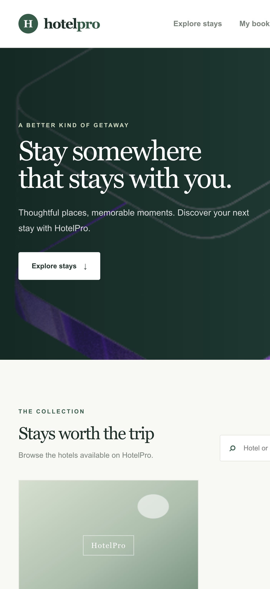
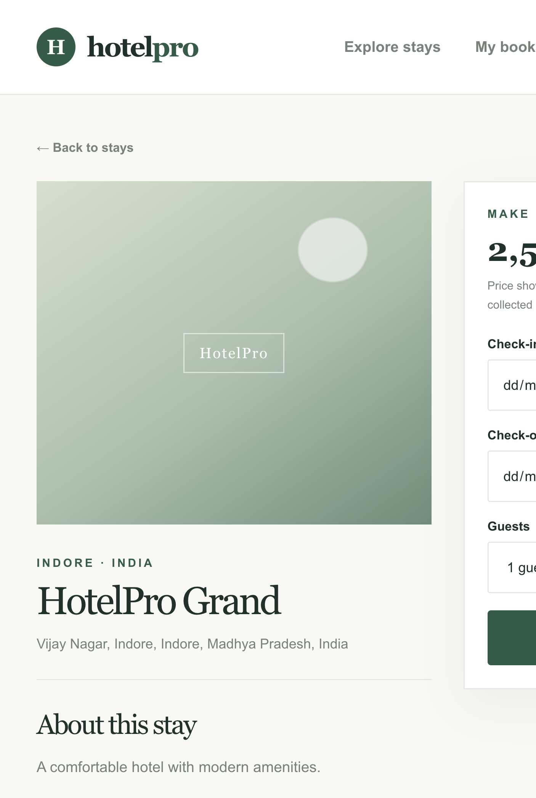
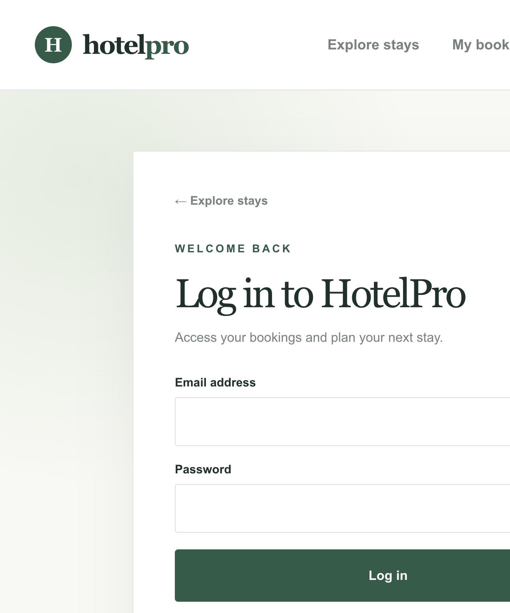
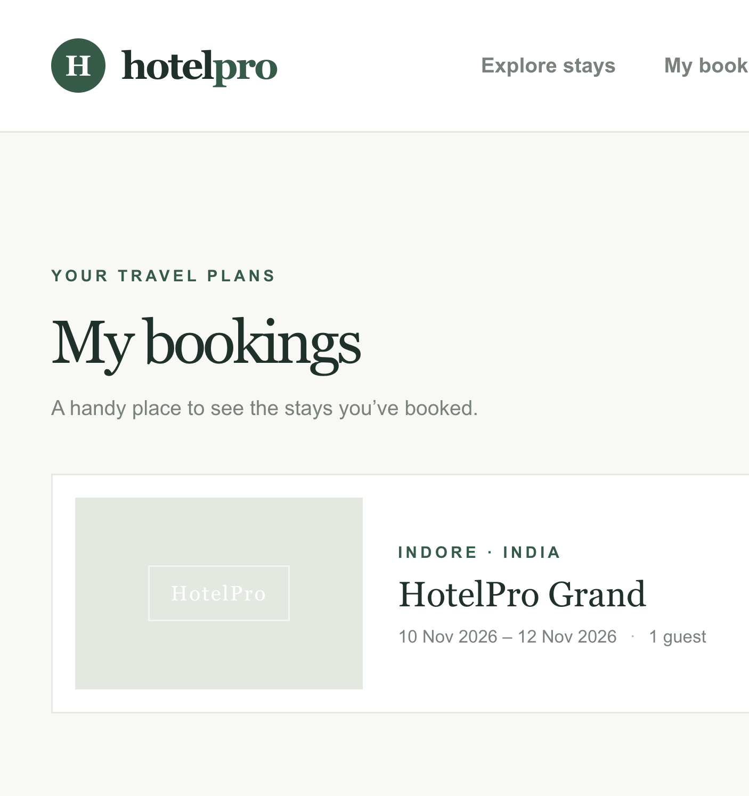

# HotelPro Project Report

**Project:** HotelPro hotel browsing and booking application
**Implementation:** React, Vite, Express, Node.js, MongoDB, and Mongoose
**Workflow verification date:** 29 October 2026

## 1. Abstract and problem statement

HotelPro provides a web interface for browsing hotel listings and managing guest bookings. The project addresses the need for a simple application where guests can discover an active hotel, inspect its details, create an account, submit a date-based booking request, and review their bookings.

The delivered system combines a React single-page application with an Express/Node.js API and MongoDB persistence. It is an MVP booking workflow, not a complete hotel inventory or payment platform.

## 2. Objectives and scope

### Objectives

- Display active hotels from the backend API.
- Provide individual hotel detail pages.
- Support guest registration and JWT-based login.
- Allow an authenticated guest to submit a booking with dates and guest count.
- Show bookings belonging to the authenticated guest.
- Provide responsive navigation, validation, loading states, and user-facing API errors.

### In scope

- Guest account registration and login.
- Public hotel browsing and detail retrieval.
- Booking creation and guest booking history.
- Admin-protected hotel creation endpoint in the backend.

### Out of scope

- **Payment processing is not implemented.**
- **Full room-availability and date-conflict management is not implemented.**
- Cancellation and hotel editing/deletion workflows are not implemented.

## 3. System architecture

```text
Browser (React 19 / Vite)
  ├─ React Router pages: listing, hotel detail, register, login, bookings
  ├─ Axios API client: VITE_API_URL and bearer token
  └─ Session token: browser sessionStorage
          │ HTTP/JSON, Authorization: Bearer <token>
          ▼
Express 5 / Node.js API
  ├─ Auth routes/controllers and JWT middleware
  ├─ Hotel routes/controllers and role authorization
  └─ Booking routes/controllers
          │ Mongoose
          ▼
MongoDB Atlas
```

The frontend is in `Front-end/frontend`; the backend is in `Back-end`. The backend loads its local `.env`, defaults CORS to the Vite origin, connects to MongoDB through Mongoose, and exposes the API routes listed below.

## 4. Database design

### User

- `name`: required, trimmed string (2–80 characters).
- `email`: required, unique, normalized to lowercase, validated format.
- `password`: required, excluded from normal queries, hashed with bcrypt before save.
- `role`: `guest`, `staff`, or `admin`.
- `isActive`: account availability flag.
- Timestamps: `createdAt`, `updatedAt`.

### Hotel

- `name`, `description`.
- `location`: city, optional state, country, address.
- `pricePerNight`, `amenities`, `roomCapacity`, optional `imageUrl`.
- `isActive` determines whether a hotel is returned to public listing/detail requests.
- Timestamps: `createdAt`, `updatedAt`.

### Booking

- `user`: required reference to `User`, indexed.
- `hotel`: required reference to `Hotel`.
- `checkIn`, `checkOut`: required dates.
- `guests`: positive whole number.
- `totalPrice`: calculated from nightly price and stay length.
- `status`: `confirmed` or `cancelled` (defaults to `confirmed`).
- Timestamps: `createdAt`, `updatedAt`.

## 5. Application modules

### Authentication

Registration creates guest accounts only; public registration cannot select a privileged role. Login compares the submitted password with the bcrypt hash and returns a signed JWT. The frontend keeps the returned token in `sessionStorage` and attaches it to protected API requests. The JWT signing secret stays on the backend.

### Hotel browsing

The landing page fetches the active hotel collection and supports client-side search over hotel name, description, and location. Each hotel links to a detail page with its address, description, amenities, capacity, and current listed nightly price.

### Booking

Authenticated guests submit `hotelId`, `checkIn`, `checkOut`, and `guests`. The API validates the input, verifies the hotel is active, checks guest count against configured hotel capacity, calculates `totalPrice`, and stores a booking. The guest bookings endpoint populates a limited hotel summary for display.

The listed calculation is not a confirmation of room availability and no payment is taken.

## 6. API endpoints and examples

All paths below are relative to `http://localhost:5001`.

### Register

`POST /api/auth/register`

Request:

```json
{
  "name": "Guest Example",
  "email": "guest@example.com",
  "password": "<8-72 character password>"
}
```

Success response (`201`), with password omitted:

```json
{
  "success": true,
  "message": "Account registered successfully.",
  "user": {
    "id": "<user-id>",
    "name": "Guest Example",
    "email": "guest@example.com",
    "role": "guest",
    "isActive": true,
    "createdAt": "<timestamp>"
  }
}
```

### Login

`POST /api/auth/login`

Request:

```json
{
  "email": "guest@example.com",
  "password": "<account password>"
}
```

Success response (`200`):

```json
{
  "success": true,
  "message": "Login successful.",
  "token": "<JWT omitted>",
  "user": {
    "id": "<user-id>",
    "name": "Guest Example",
    "email": "guest@example.com",
    "role": "guest"
  }
}
```

Protected requests use `Authorization: Bearer <JWT>`.

### List hotels

`GET /api/hotels`

Success response (`200`) has the shape:

```json
{
  "success": true,
  "count": 1,
  "hotels": [
    {
      "_id": "<hotel-id>",
      "name": "HotelPro Grand",
      "pricePerNight": 2500,
      "isActive": true
    }
  ]
}
```

The actual hotel records also include description, location, amenities, capacity, image URL, and timestamps where available.

### Get one hotel

`GET /api/hotels/:id`

Success response (`200`):

```json
{
  "success": true,
  "hotel": {
    "_id": "<hotel-id>",
    "name": "HotelPro Grand",
    "location": {
      "city": "Indore",
      "country": "India"
    },
    "pricePerNight": 2500
  }
}
```

### Create booking

`POST /api/bookings` (authenticated)

Request:

```json
{
  "hotelId": "<hotel-id>",
  "checkIn": "2026-11-10",
  "checkOut": "2026-11-12",
  "guests": 1
}
```

Success response (`201`) includes `{ "success": true, "message": "...", "booking": { ... } }`. The live workflow returned a confirmed booking for two nights at a listed total of 5,000 (currency is not defined by the current API).

### List my bookings

`GET /api/bookings/my` (authenticated)

Success response (`200`) has the shape:

```json
{
  "success": true,
  "count": 1,
  "bookings": [
    {
      "_id": "<booking-id>",
      "hotel": {
        "name": "HotelPro Grand",
        "location": {
          "city": "Indore",
          "country": "India"
        },
        "pricePerNight": 2500
      },
      "checkIn": "2026-11-10T00:00:00.000Z",
      "checkOut": "2026-11-12T00:00:00.000Z",
      "guests": 1,
      "totalPrice": 5000,
      "status": "confirmed"
    }
  ]
}
```

Other routes include `GET /api/auth/me`, `GET /api/auth/admin-test`, and admin-protected `POST /api/hotels`.

## 7. Testing results and screenshots

### Automated checks

- Frontend production build: **passed** with `cd "Front-end/frontend" && npm run build`.
- Frontend lint: **passed** with `cd "Front-end/frontend" && npm run lint`.
- Live backend health endpoint: **HTTP 200**.
- Live hotel list endpoint: **HTTP 200**, one active hotel returned during verification.

### Live browser workflow

All four requested workflow checks were run in the browser against the local frontend and live backend:

| Check | Result | Observed outcome |
|---|---|---|
| Open HotelPro Grand details | Passed | Detail page displayed location, amenities, capacity, and nightly price. |
| Register and log in | Passed | Account registration succeeded; login returned to the site with the authenticated navigation. |
| Create booking | Passed | Booking for 10–12 November 2026 was accepted; success confirmation appeared. |
| View My Bookings | Passed | The saved HotelPro Grand booking appeared as `confirmed` for 1 guest with listed total 5,000. |

The browser run created a workflow test account and a booking record in the connected development database. The test password and JWT are intentionally not included in this report.

### Browser screenshots

These are real screenshots captured from the running local application during the verification session:

**Hotel listing**



**Hotel detail and booking form**



**Login form**



**Saved booking in My Bookings**



## 8. Limitations and future enhancements

### Current limitations

- Payment processing is not implemented; the booking flow does not collect card or payment details.
- Full room availability and overlapping date conflict checks are not implemented.
- The booking route checks active hotel status and configured guest capacity, not real inventory.
- Currency formatting is not backed by a configured currency code.
- Guest cancellation and admin hotel update/delete endpoints are not implemented.
- The API does not include dedicated automated backend integration tests in the current project.

### Future enhancements

- Add room/inventory and per-date availability models, transactions, and conflict prevention.
- Add a payment provider integration with secure payment status handling.
- Add booking cancellation, hotel management, and role-specific dashboards.
- Add pagination and server-side hotel search.
- Add backend integration tests and deployment/environment documentation.

## 9. Setup instructions and conclusion

1. Install Node.js and npm.
2. Configure `Back-end/.env` with `PORT`, `MONGODB_URI`, `JWT_SECRET`, and optional `JWT_EXPIRES_IN` and `CLIENT_URL`. Keep credentials private.
3. Configure `Front-end/frontend/.env.local` with `VITE_API_URL=http://localhost:5001/api`.
4. In one terminal, run `cd Back-end && npm install && npm run dev`.
5. In another terminal, run `cd "Front-end/frontend" && npm install && npm run dev`.
6. Open `http://localhost:5173`. Confirm the Atlas cluster is running and allows the development machine's IP.

HotelPro now demonstrates an end-to-end guest flow from hotel discovery through booking history. The verified frontend and current API workflow work against the development database, with payment and full inventory management explicitly remaining outside the delivered scope.
